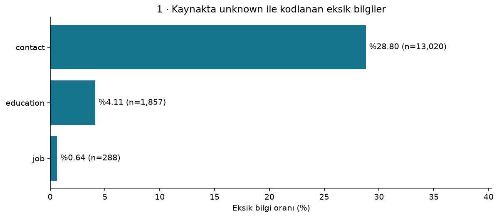
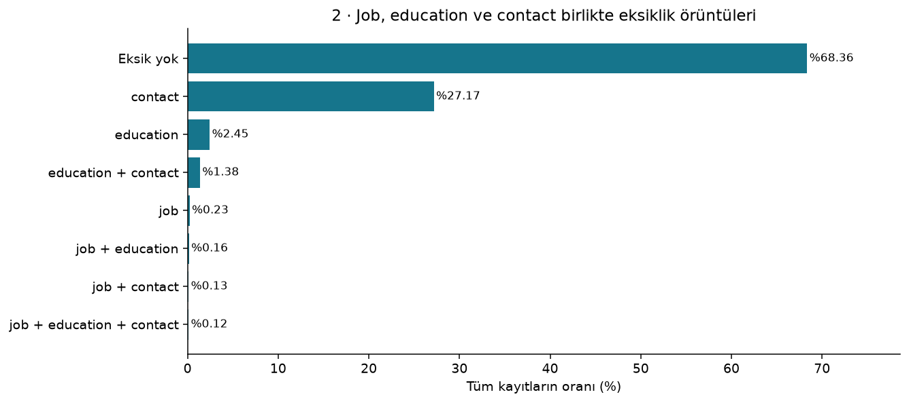
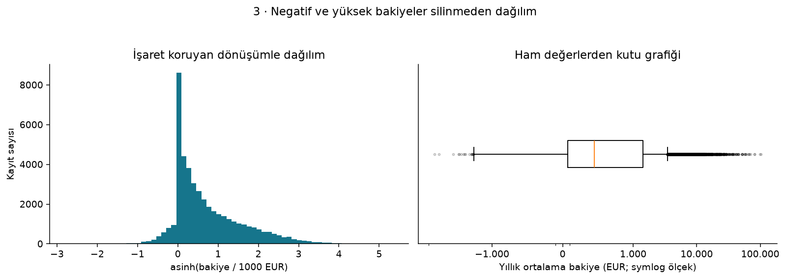
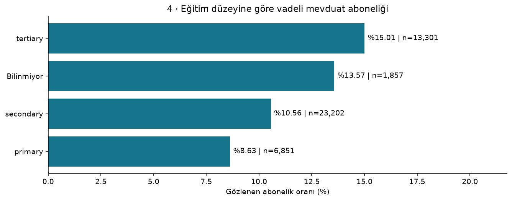
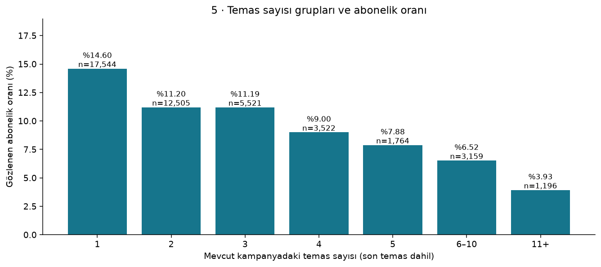
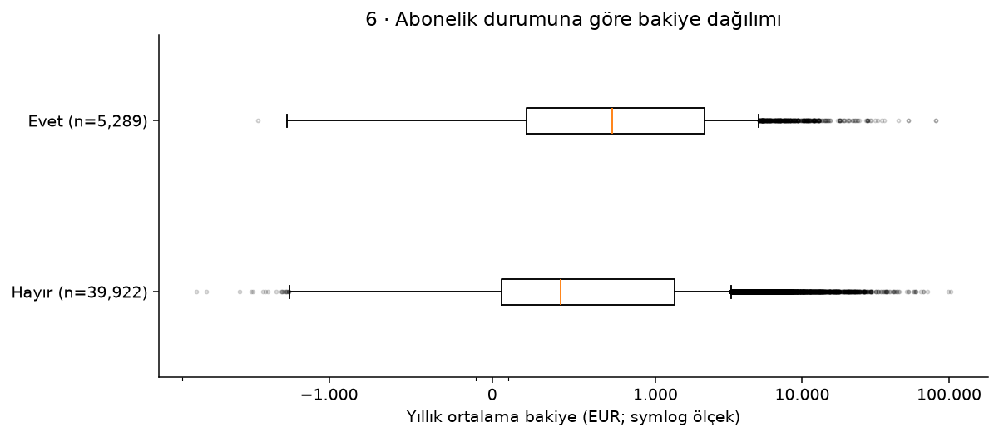
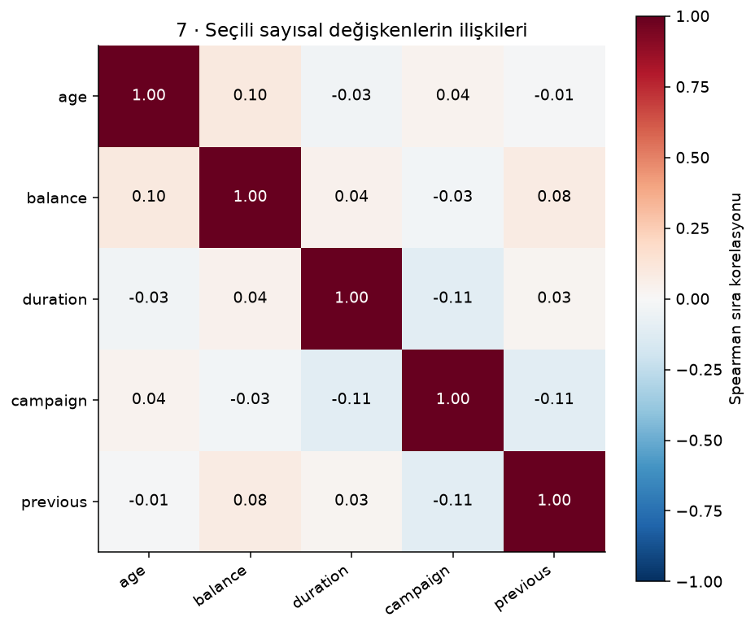

# Bulgular ve Sınırlamalar

## Araştırma soruları

1. Eksik müşteri ve temas bilgileri hangi sütunlarda, hangi birlikte eksiklik örüntülerinde yoğunlaşıyor?
2. Yıllık ortalama bakiye nasıl dağılıyor; IQR ile işaretlenen gözlemler ve negatif bakiyeler nasıl yorumlanmalı?
3. Gözlenen vadeli mevduat abonelik oranları eğitim düzeyi ve kampanya temas sayısı gruplarında nasıl farklılaşıyor?

## Veri ve temizleme

Ham ve temiz veri: 45,211 kayıt. Satır silinmedi, değer doldurulmadı; ham dosya hash'i değişmedi.
Birebir aynı özellikli tekrar sayısı: 0. Müşteri kimliği olmadığından tekrar olsaydı dahi otomatik silinmeyecekti.
Üç alandan en az biri eksik 14,304 kayıt var. Bu gözlemler tutuldu.
Önceki temas gün kodu ile previous>0 tutarsızlığı: 0 kayıt.
Önceki sonuç durumu: {'not_applicable_no_prior_contact': 36954, 'observed': 8252, 'unknown_despite_prior_contact': 5}.
UCI'nin 'eksik yok' açıklaması literal eksiklik içindir; unknown bilgi belirsizliğini ayrı analiz ettik.

## Grafikler ve yorumlar

### Eksik bilgi hangi alanlarda yoğunlaşıyor?

**Bulgu:** En yüksek eksik bilgi oranı contact alanında: %28.80 (n=13,020).

**Sınırlama:** UCI üst verisi boş/NA değer olmadığını bildirir; burada ölçülen, gerçek unknown kodlarının anlamsal eksikliğidir. Eksiklik mekanizması kanıtlanmaz.

### Eksik bilgiler birlikte mi görülüyor?

**Bulgu:** Üç alanda da bilgi bulunan 30,907 kayıt var; en az bir eksik alanı olan 14,304 kayıt korunuyor.

**Sınırlama:** Örüntüler yalnız bu üç alanı kapsar; MCAR, MAR veya MNAR sınıflaması için tek başına yeterli değildir.

### Bakiye dağılımı ve aykırı gözlemler

**Bulgu:** Ortalama 1362.27 EUR, medyan 448.00 EUR; negatif bakiyeli 3,766 kayıt var. IQR kuralı 4,729 bakiyeyi işaretliyor (%10.46).

**Sınırlama:** IQR etiketi veri hatası değildir; negatif bakiye de otomatik hata sayılmaz. asinh ve symlog yalnız görselleştirme içindir; temiz bakiye değerleri değiştirilmez.

### Eğitim gruplarında gözlenen oranlar nasıl?

**Bulgu:** En yüksek oran tertiary grubunda %15.01; en düşük primary grubunda %8.63. Paydalar grafikte gösteriliyor; eksik eğitim ayrı grupta tutuldu.

**Sınırlama:** Bunlar örneklem içi betimsel oranlardır; eğitim etkisi veya nedensel fark değildir. Yaş, gelir, seçim ve kampanya bileşimi kontrol edilmedi; güven aralığı veya hipotez testi yapılmadı.

### Temas sayısı grupları nasıl farklılaşıyor?

**Bulgu:** Tek temas grubunda oran %14.60 (n=17,544); 11+ temas grubunda %3.93 (n=1,196).

**Sınırlama:** Temas sayısı rastgele atanmadı; zor ikna edilen kayıtlarda daha fazla temas olabilir. Bu sonuçtan arama sayısını azaltmanın aboneliği artıracağı çıkarılamaz.

### Abone olan ve olmayan kayıtlarda bakiye nasıl?

**Bulgu:** Medyan bakiye: abone olmayanlarda 417.00 EUR; olanlarda 733.00 EUR. Her iki grupta da uç değerler korundu.

**Sınırlama:** Gruplar eş büyüklükte değil; bakiye farkı aboneliğe neden olan bir etki veya müşteri geliri ölçümü değildir. Tek bir ortalama/medyan tüm dağılımı anlatmaz.

### Sayısal değişkenler arasında sıralı ilişki var mı?

**Bulgu:** Gösterilen çiftlerde mutlak değeri en büyük Spearman katsayısı campaign–previous için -0.108.

**Sınırlama:** Seçili ilişkiler betimseldir; sıfıra yakın katsayı tüm bağımlılıkları dışlamaz. pdays=-1 yapısal kodu korelasyona alınmadı. duration görüşme sonrası bilinir; önceden hedefleme özelliği gibi kullanılamaz.

## Temsil edilebilirlik

Veri, Portekiz'de tek bir bankanın 2008–2010 dönemi telefon kampanyası kayıtlarıdır. Tüm banka müşterilerini, güncel Türkiye piyasasını veya rastgele bir nüfus örneklemini temsil ettiği varsayılmaz.
Müşteri kimliği ve tam tarih yoktur. Satırların benzersiz müşteri olduğunu kanıtlayamayız; bağımsızlık varsayımıyla hipotez testi yapmadık.
Abonelik oranları yalnız kayıtların gözlenen dağılımını tanımlar. Nedensellik, p değeri veya model başarısı iddiası yoktur.

## Betimsel istatistikleri okuma

Ortalama ve medyan bakiye farkı sağ kuyruğun etkisini gösterir; standart sapma uç değerlere duyarlıdır. Çeyrekler dağılımın orta bölümünü özetler.
previous alanında IQR sıfır olabileceğinden, nadir fakat geçerli önceki temaslar da işaretlenebilir. Bu kural bir silme talimatı değildir.
Ayrıntılı sayılar reports/tables CSV'lerinde; alan bazında kararlar docs/cleaning_decisions.md dosyasında.